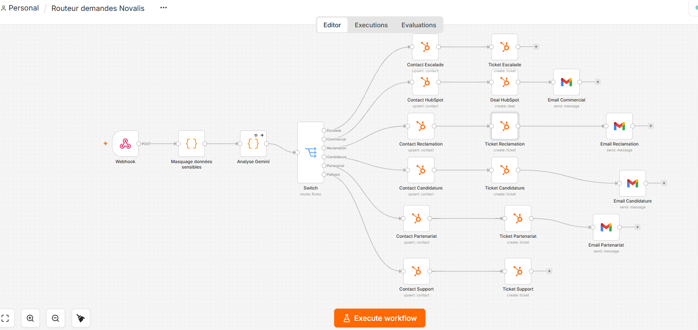
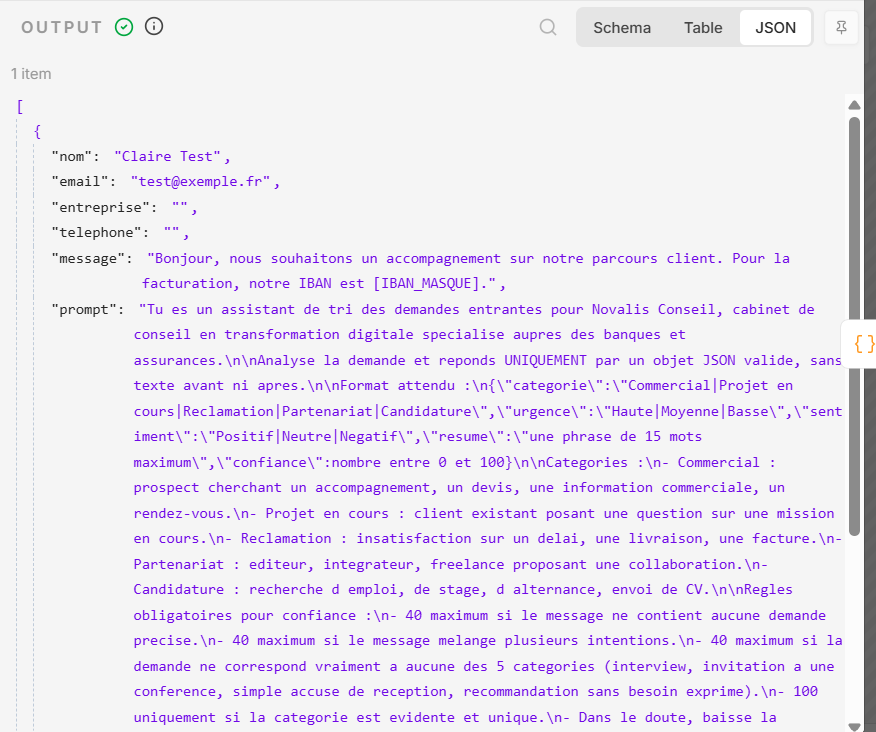
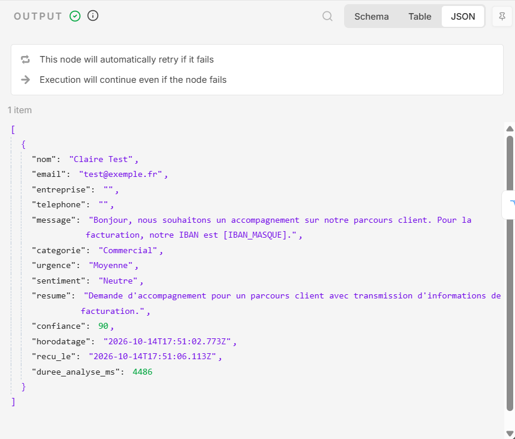
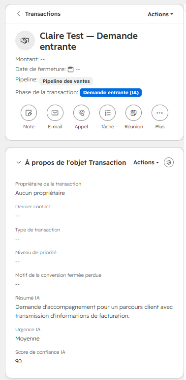
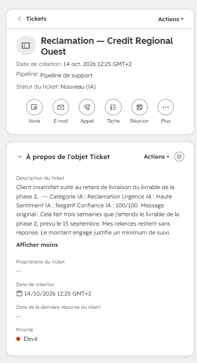
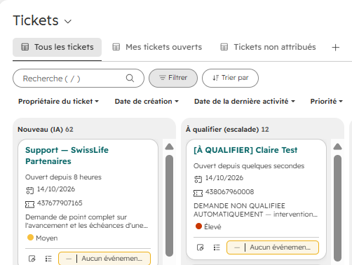
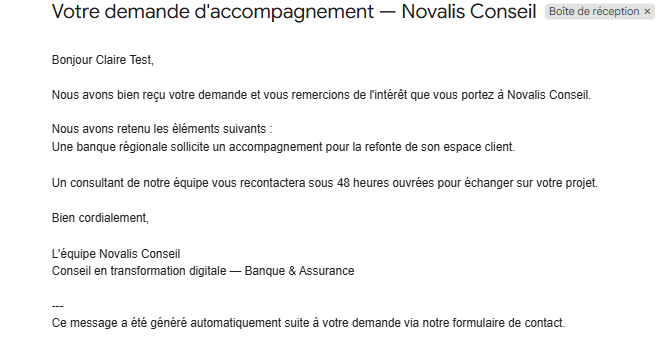

# Routeur intelligent de demandes clients

Un flux automatisé qui reçoit les demandes entrantes d'un cabinet de conseil, les analyse avec un LLM, crée l'enregistrement adapté dans le CRM et envoie une première réponse au client. Quand l'IA n'est pas sûre d'elle, la demande part chez un humain et aucune réponse automatique n'est envoyée.

**Contexte fictif** : *Novalis Conseil*, cabinet de conseil en transformation digitale spécialisé banque et assurance. Toutes les demandes utilisées sont fictives.

**Stack** : n8n (auto-hébergé, Docker) · API Gemini · HubSpot CRM · Gmail · Google Forms + Apps Script · Cloudflare Tunnel

---

## Résultats en bref

Mesurés sur un jeu de test de 40 demandes, avant puis après correction du prompt :

| Indicateur | Version 1 | Version 2 |
|---|---|---|
| Catégorie correcte | 39/40 (97,5 %) | **40/40 (100 %)** |
| Cas ambigus envoyés à un humain | 1 sur 9 | **6 sur 9** |
| Réponses automatiques sur un cas ambigu | 7 | **2** |
| Réponses automatiques dans la mauvaise catégorie | 1 | **0** |
| Exécutions réussies | 40/40 | 40/40 |
| Latence bout-en-bout, médiane | 3,0 s | 3,0 s |

Le test a d'abord révélé une faille : le garde-fou laissait passer presque tous les cas douteux. Elle a été corrigée, puis mesurée à nouveau. Le détail et les limites sont plus bas.

---

## Le flux



```
Formulaire Google ──► Apps Script ──► Cloudflare Tunnel ──► Webhook n8n
                                                                 │
                                       Masquage des données sensibles (IBAN, NIR, carte)
                                                                 │
                                   Analyse Gemini : catégorie, urgence, sentiment, résumé, confiance
                                                                 │
                                                        Switch (6 sorties)
     ┌──────────────┬──────────────┬──────────────┬──────────────┬──────────────┐
  Escalade      Commercial     Réclamation    Candidature    Partenariat    Support
 (confiance       │              │              │              │          (repli)
   < 60)        Contact        Contact        Contact        Contact        Contact
     │          + Deal         + Ticket       + Ticket       + Ticket       + Ticket
  Contact         │              │              │              │              │
  + Ticket      Email          Email          Email          Email        pas d'email
 « À qualifier »
  pas d'email
```

### Les choix de conception

**L'escalade est testée en premier.** Avant même de regarder la catégorie, le Switch vérifie la confiance du modèle. Si le modèle doute, sa catégorie ne vaut rien : la demande part chez un humain, sans réponse automatique. Mieux vaut un client qui attend une vraie réponse qu'un client qui reçoit une réponse à côté.

**Les données sensibles sont masquées avant l'appel à l'API.** Dans le secteur banque et assurance, les clients écrivent spontanément leur IBAN, leur numéro de sécurité sociale ou un numéro de carte. Un nœud Code les remplace par `[IBAN_MASQUE]`, `[NIR_MASQUE]` et `[CARTE_MASQUEE]` avant que le message ne parte vers Gemini. L'email et le téléphone du client ne sont jamais envoyés au modèle.

**Le modèle classe, il ne rédige pas.** Gemini produit un JSON structuré : catégorie (liste fermée de 5 valeurs), urgence, sentiment, résumé d'une ligne et score de confiance. Les emails sont des modèles fixes, dans lesquels n8n insère seulement le prénom et le résumé. Dans un secteur réglementé, une réponse automatique ne doit jamais ressembler à du conseil.

**Les règles métier restent des règles.** Les candidatures et les partenariats ont toujours une priorité basse, quelle que soit l'urgence estimée par le modèle. Ce n'est pas une décision d'IA.

**Configuration de l'appel au modèle**

- Modèle : `gemini-3.1-flash-lite`. C'est le plus léger, donc le plus rapide et le moins limité en quota. Classer un texte court dans 5 catégories ne demande pas de modèle de raisonnement.
- `temperature: 0.1` : la même demande doit donner la même catégorie.
- `responseMimeType: application/json` : c'est l'API qui garantit un JSON valide, pas seulement le prompt.
- Reprise automatique : 4 tentatives espacées de 5 secondes, pour absorber les saturations ponctuelles de l'API (erreurs 503).

---

## En images

| Masquage avant l'appel à l'IA | Analyse produite par Gemini |
|---|---|
|  |  |

| Transaction enrichie dans HubSpot | Ticket enrichi dans HubSpot |
|---|---|
|  |  |

| Traités seuls / escaladés vers un humain | Réponse automatique reçue |
|---|---|
|  |  |

---

## Le jeu de test

**Composition.** 40 demandes fictives : 15 commerciales, 7 projets en cours, 7 réclamations, 6 partenariats, 5 candidatures. Neuf sont volontairement difficiles :
- messages sans demande précise (« Bonjour, j'ai une question ») ;
- intentions mêlées ;
- demandes hors catégorie (interview d'étudiante, invitation à une conférence, simple accusé de réception).

**Référence.** Les 40 demandes ont été pré-annotées par un modèle de langage, puis relues et validées manuellement, ligne par ligne (40/40, sans correction). La pré-annotation a pu influencer la relecture : le résultat est donc à considérer comme légèrement optimiste. Une annotation entièrement indépendante, ou par une seconde personne, renforcerait la mesure.

**Envoi.** Un script PowerShell envoie les 40 demandes directement au webhook, par lots de 10, avec 90 secondes de pause pour respecter le quota gratuit de Gemini. Les adresses email sont des alias de ma propre boîte (`+nvl01` à `+nvl40`) : HubSpot les voit comme 40 contacts distincts, et aucun email automatique n'est envoyé à un inconnu.

**Extraction.** Un second script lit les 40 exécutions via l'API n8n et produit un CSV comparable à la grille d'annotation.

### Version 1 : une faille révélée

La classification était déjà très bonne (39/40). Le garde-fou, lui, ne fonctionnait presque pas : Gemini s'attribuait 70 à 95 % de confiance sur des messages qu'un humain aurait dû trancher. Sur les 9 cas ambigus, un seul est parti en escalade, et 7 ont reçu une réponse automatique. Une étudiante qui demandait une interview a ainsi reçu un email de partenariat.

Le score de confiance qu'un modèle s'attribue lui-même ne suffit pas comme garde-fou.

### La correction

J'ai donné au modèle des règles explicites au lieu de le laisser juger seul. La confiance doit être de 40 maximum si le message :
- ne contient aucune demande précise ;
- mélange plusieurs intentions ;
- ne correspond à aucune des 5 catégories.

### Version 2

| | V1 | V2 |
|---|---|---|
| Catégorie correcte | 97,5 % | 100 % |
| Accord sur l'urgence | 62,5 % | 65 % |
| Escalades | 1 | 7 |
| Emails automatiques envoyés | 33 | 27 |
| Réponses automatiques dans la mauvaise catégorie | 1 | 0 |
| Latence, 90 % des demandes sous | 12,7 s | 3,7 s |

Le compromis : 6 réponses automatiques en moins, en échange de zéro réponse envoyée dans la mauvaise catégorie.

**Ce qui reste imparfait :**
- **Deux cas ambigus reçoivent encore une réponse automatique.** Une invitation à une conférence a été classée Partenariat, une simple recommandation a été classée Commercial. Le modèle les juge claires à 90 %.
- **Une escalade est discutable.** Un prospect qui écrit « je transmets votre plaquette à la direction » a été escaladé, alors que la référence le classait Commercial. Le message ne contient aucune demande : l'envoyer à un humain se défend.
- **L'urgence est surestimée.** Le modèle met « Moyenne » là où la référence met « Basse », surtout sur les candidatures et les partenariats. C'est sans effet pratique : leur priorité est forcée par une règle métier.
- **Une latence anormale.** Une exécution sur 40 a pris 71 s, contre environ 3 s pour les autres. C'est probablement une série de reprises après une saturation de l'API, à confirmer.

---

## Contraintes rencontrées

Elles ont façonné le design.

| Contrainte | Conséquence |
|---|---|
| HubSpot gratuit : un seul pipeline par objet | Le routage s'appuie sur deux objets distincts : les demandes commerciales deviennent des Deals, les autres des Tickets. |
| HubSpot gratuit : 10 propriétés personnalisées pour tout le compte | Seuls les champs qui déclenchent une action ou alimentent une mesure ont été créés. |
| Le nœud HubSpot de n8n n'expose pas les propriétés personnalisées des tickets | L'analyse de l'IA (catégorie, urgence, sentiment, confiance, message d'origine) est écrite dans la description du ticket. Sur les Deals, elle va dans des propriétés dédiées. |
| Google Forms ne sait pas appeler un webhook | Un script Apps Script `onFormSubmit` envoie chaque réponse à n8n. |
| Le nœud HTTP Request de n8n doublait l'échappement du JSON envoyé à Gemini | L'appel à l'API est fait directement dans un nœud Code. |
| Le tier gratuit de Gemini peut réutiliser les requêtes | Uniquement des données fictives. En production, il faudrait un tier payant ou Vertex AI, avec une clause de non-réutilisation. |
| Problèmes d'encodage des accents entre services | Le prompt est écrit sans accents, et les conditions du Switch suivent cette convention (`Reclamation`). |

---

## Incidents et leur diagnostic

- **Tunnel éphémère.** L'URL gratuite de Cloudflare change à chaque redémarrage, et un tunnel peut aussi tomber en cours de session. Environ 23 % des exécutions du script Apps Script ont échoué vers une URL devenue invalide. Voir les pistes d'amélioration.
- **Emails envoyés en triple.** Chaque soumission produisait trois exécutions. Cause : trois déclencheurs `onFormSubmit` accumulés lors des reconfigurations. Corrigé en n'en gardant qu'un.
- **Modèle retiré.** Le premier modèle choisi n'était plus disponible pour les nouveaux comptes. Le modèle a été choisi dans la liste renvoyée par l'endpoint `/models` de l'API, plutôt qu'au hasard.
- **Noms vides dans le jeu de test.** Les emails envoyés pendant le test commençaient par « Bonjour , » et les tickets d'escalade n'avaient pas de nom. Cause : Windows PowerShell 5.1 lit un script UTF-8 sans BOM comme du Windows-1252. Les clés accentuées du script d'envoi (« Nom et prénom », « Téléphone ») arrivaient déformées dans n8n, et ces deux champs restaient vides. Le nom n'intervient pas dans la classification, qui repose sur l'entreprise et le message. Corrigé en enregistrant le script en UTF-8 avec BOM.
- **Quota dépassé (429).** Les tentatives répétées de débogage ont épuisé le quota par minute. D'où l'espacement des reprises et l'envoi du jeu de test par lots.

---

## Données personnelles et conformité

- Le formulaire informe la personne que sa demande fait l'objet d'une analyse automatisée et qu'un collaborateur reste responsable du traitement (RGPD, art. 13). Le tri automatisé des demandes relève du profilage (art. 4(4)). L'application éventuelle de l'art. 22 (décision entièrement automatisée) dépend des effets produits, et serait à faire trancher par un DPO en contexte réel.
- Chaque email automatique indique qu'il a été généré automatiquement.
- Les données sensibles sont masquées avant tout appel à un service tiers.
- L'accès Gmail visait le seul envoi d'emails (`gmail.send`). L'écran de consentement de Google regroupait cette permission dans une autorisation plus large (consulter, rédiger et envoyer), seule proposée pour l'envoi.

---

## Limites connues

- Une adresse email invalide fait échouer la création du contact dans HubSpot, et la demande est perdue. Il faudrait une validation en amont.
- Le nom et le prénom sont saisis dans un seul champ, stocké dans le prénom HubSpot.
- L'entreprise est stockée comme propriété texte du contact, sans objet Entreprise associé.
- L'alerte manager sur les réclamations urgentes, prévue au départ, n'a pas été construite.
- Aucune comparaison avec un temps de traitement manuel n'a été mesurée. Tout chiffre de ce type serait une hypothèse.
- Le coût par demande n'a pas été mesuré : la consommation de tokens n'est pas journalisée.
- Le jeu de test est petit (40 demandes) et rédigé par l'équipe projet. Il ne remplace pas des demandes réelles.

---

## Pistes d'amélioration

1. Ajouter au JSON du modèle un champ explicite « hors catégorie », qui force l'escalade, au lieu de s'appuyer uniquement sur le score de confiance. Cela vise les deux cas encore mal traités.
2. Stabiliser l'URL publique : tunnel Cloudflare nommé avec un nom de domaine, ou petit VPS.
3. Valider l'email avant la création du contact.
4. Écrire les propriétés personnalisées des tickets via l'API HubSpot.
5. Journaliser les tokens consommés, pour mesurer le coût par millier de demandes.
6. Construire l'alerte manager (réclamation + urgence haute + sentiment négatif).

---

## Contenu du dépôt

```
├── README.md
├── workflow/
│   └── routeur-demandes.json          export du workflow n8n (sans identifiants)
├── apps-script/
│   └── onFormSubmit.gs                envoi des réponses du formulaire vers n8n
├── jeu-de-test/
│   ├── demandes_40.csv                les 40 demandes fictives
│   ├── grille_annotation.xlsx         la référence, relue manuellement
│   ├── resultats_v1_avant_correction.csv
│   └── resultats_v2_apres_correction.csv
├── scripts/
│   ├── envoi_jeu_de_test.ps1          envoie les 40 demandes au webhook
│   ├── extraction_resultats.ps1       récupère les résultats via l'API n8n
│   ├── demarrer_novalis.ps1 / .bat    relance Docker, le tunnel et n8n en un clic
│   └── n8n.env.example                modèle du fichier de secrets
└── captures/
```

---

## Lancer le projet

Prérequis : Docker Desktop, cloudflared, un compte HubSpot gratuit, une clé API Gemini, un projet Google Cloud avec l'API Gmail activée.

```powershell
docker volume create n8n_data

cloudflared tunnel --url http://localhost:5678

docker run -d --name n8n --restart unless-stopped -p 5678:5678 `
  -v n8n_data:/home/node/.n8n `
  -e GENERIC_TIMEZONE=Europe/Paris -e TZ=Europe/Paris `
  -e WEBHOOK_URL=https://<url-du-tunnel>/ `
  -e N8N_EDITOR_BASE_URL=http://localhost:5678/ `
  -e N8N_PROXY_HOPS=1 `
  docker.n8n.io/n8nio/n8n
```

`N8N_EDITOR_BASE_URL` sur localhost permet à la connexion OAuth Gmail de revenir sur la même origine que l'éditeur, indépendamment du tunnel.

Ou, sous Windows : copier `scripts/n8n.env.example` en `scripts/n8n.env`, y mettre la clé Gemini, puis double-cliquer sur `scripts/demarrer_novalis.bat`.

Ensuite :
1. Importer `workflow/routeur-demandes.json` dans n8n.
2. Renseigner les identifiants HubSpot, Gmail et Gemini.
3. Coller l'URL de production du webhook dans le script Apps Script du formulaire.

Aucune clé ni aucun identifiant ne figure dans ce dépôt.
